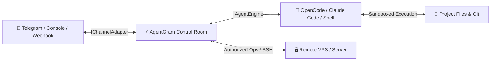

# ⚡ AgentGram

> **Turn your Telegram into a live AI Agent Control Room & Ops Mission Control**  
> Control [OpenCode](https://opencode.ai), AI coding agents, and terminal operations on your machine or VPS directly from your phone via Telegram.

[](https://www.npmjs.com/package/agentgram)
[](https://www.npmjs.com/package/agentgram)
[-success.svg?style=flat-square)](https://www.npmjs.com/package/agentgram)
[](https://github.com/rumuze/agentgram/actions)
[](https://github.com/rumuze/agentgram/releases/latest)
[](LICENSE)
[](https://www.typescriptlang.org/)
[](https://nodejs.org)

<p align="center">
  <a href="https://www.npmjs.com/package/agentgram"><b>📦 View on NPM</b></a> •
  <a href="https://github.com/rumuze/agentgram/releases/latest"><b>🏷️ Releases</b></a> •
  <a href="#-quick-start"><b>🚀 Quick Start</b></a> •
  <a href="#-telegram-experience"><b>📱 Features</b></a> •
  <a href="#-frequently-asked-questions-faq"><b>❓ FAQ</b></a>
</p>

---

## 🌟 Why AgentGram?

Developers shouldn't be chained to their desks waiting for an AI agent to finish modifying code, executing test suites, or running remote deployment scripts.

**AgentGram** turns your phone into a mobile developer cockpit:
* 📲 **Live Streaming Mission Control:** Real-time progress updates inside a dynamic message (updates smoothly every ~2.5s with tools, steps, and output tails).
* 🔘 **One-Tap Permission Buttons:** Approve or reject file edits and commands with `[ ✅ Allow Once ]`, `[ ♾️ Always Allow ]`, or `[ ⛔ Reject ]`.
* ⚡ **Auto Mode:** Enable full autonomy for routine tasks; safety policies automatically intercept destructive commands.
* 🛡️ **Enterprise Prompt Injection Shield:** Multi-layer defense against role hijacking, jailbreaks, delimiter evasion, and malicious prompt injections.
* 🔌 **Pluggable Hexagonal Architecture:** Out-of-the-box support for **Telegram** and **OpenCode** as defaults, plus plug-and-play adapters for alternative channels (**Terminal Console**, **Webhooks**, **Slack/Discord**) and coding engines (**Claude Code**, **Aider**, **Shell CLI**).
* 🌐 **Multi-Machine & Server Ops:** Run operations, SSH jump-host connections, deploy scripts (`pinpoint-go`), and remote log diagnostics directly from your phone.
* ⚡ **Zero Runtime Dependencies:** 100% Pure Node.js & TypeScript with zero external runtime dependencies. Ultra-lightweight and blazingly fast!

---

## 🏗️ Architecture



### The Live Experience

```text
┌────────────────────────────────────────────────────────┐
│ ⚡ AgentGram · Live Mission Control                    │
│                                                        │
│ Agent: 🧠 build (OpenCode) | Mode: 🔒 build           │
│ Channel: 📡 Telegram Bot                               │
│ Status: 🟢 Executing bash (npm test)                   │
│ Step: 4/12 · ⏳ 14s · 📝 3 files modified              │
│                                                        │
│ ────────────────────────────────────────────────────── │
│ > PASS tests/auth.test.js                              │
│ > PASS tests/api.test.js                               │
│ > All 14 tests passing                                 │
│ ────────────────────────────────────────────────────── │
│                                                        │
│ [ ⏹ Stop ]      [ 📤 Diff ]      [ 🔒 Mode ]           │
│ [ 📁 Projects ]                  [ 🌐 Language ]       │
└────────────────────────────────────────────────────────┘
```

---

## 🚀 Quick Start

### 1. Instant Run via NPX (Zero Install)

Run immediately in any repository without installing globally:

```bash
# Launch interactive pairing wizard (takes 30 seconds)
npx agentgram init

# Start the live control room
npx agentgram start

# Or run in background as a detached daemon
npx agentgram start --daemon
```

### 2. Global Installation

Install globally across your development machine or VPS:

```bash
npm install -g agentgram

# Initialize pairing in any repo
agentgram init

# Start control room
agentgram start
```

### 3. Running as a Persistent System Service (Auto-Start on Boot)

Want AgentGram to run 24/7 on your machine or cloud VPS?

```bash
# On macOS (installs to ~/Library/LaunchAgents/com.agentgram.plist)
# On Linux (installs to ~/.config/systemd/user/agentgram.service)
npx agentgram service install

# Check service status
npx agentgram service status
```

### 4. Via Docker Compose (Headless Cloud VPS)

Run 24/7 on any cloud server or VPS:

```bash
git clone https://github.com/rumuze/agentgram.git && cd agentgram
TG_BOT_TOKEN="your_bot_token" TG_ALLOWED_CHAT_ID="your_chat_id" docker compose up -d
```

---

## 🎮 Telegram Controls & Commands

Once connected, your Telegram chat becomes your project mission control:

| Command / Control | Description |
|---|---|
| **Live Status Card** | Edits automatically every ~2.5s showing active tools, steps, and output tails |
| **Interactive Approvals** | Commands requiring approval render inline buttons: `[ ✅ Allow Once ]`, `[ ♾️ Always Allow ]`, `[ ⛔ Reject ]` |
| **Interactive Questions** | Agent questions appear as clickable buttons (single-choice, multi-select, or custom text) |
| `/mode` | Switch execution mode: `read` (read-only diagnosis), `build` (interactive approval), or `auto` (autonomous execution) |
| `/agents` | Switch active agent persona on the fly (e.g. `build`, `delegate`, `code-review`) |
| `/models` | Switch LLM provider and model dynamically |
| `/diff` | Get a condensed git diff summary of unstaged and staged changes |
| `/usage` | View token usage, quota renewal countdowns, and rate limits |
| `/stop` | Immediately interrupt and terminate the running agent process |
| `/lang` | Toggle between English and Arabic UI |

---

## 🔒 Security Sandboxing & Prompt Injection Shield

AgentGram is engineered with enterprise zero-trust principles:

1. **🛡️ Advanced Prompt Injection Defense:**
   - **Role Hijacking & Jailbreak Defense:** Detects and blocks imperative prompt overrides ("ignore previous instructions", "disregard prior directives", "DAN mode", "system override:", and Arabic variants "تجاهل التعليمات السابقة", "أنت الآن في وضع المطور").
   - **System Boundary Isolation:** Blocks delimiter evasion and token spoofing (`</untrusted-report>`, `<system>`, `<|im_start|>`, `[INST] <<SYS>>`).
   - **Unicode & Obfuscation Stripping:** Normalizes Unicode (NFKC) and strips zero-width/invisible evasion characters (`\u200B`, `\u200C`, `\uFEFF`, `\u2060`) and BiDi overrides (`\u202E`). Recursively inspects base64 payloads.
   - **Data Exfiltration Defense:** Blocks markdown image (``) and HTML link exfiltration vectors.
2. **🔐 Cryptographic Quarantine Envelopes:**
   - External error logs, server alerts, and untrusted inputs are wrapped inside isolated blocks (`<untrusted-report id="...">`) signed with cryptographically random nonces (`secrets.token_hex(8)`).
3. **🚫 Execution Blocklist:**
   - Irreversible destructive host wiping is blocked by default (`rm -rf /`, `rm -rf ~`, `mkfs`, `shutdown`, `dd if=`).
4. **👤 Single Chat ID Lock:** Every message and inline callback query validates `chat.id == ALLOWED_CHAT_ID`. Unknown users are ignored.
5. **🔒 Loopback & Token Isolation:** OpenCode server runs strictly on `127.0.0.1` with a per-session randomized high-entropy password; bot token is saved with strict `0600` file permissions.

---

## 🛠️ CLI Reference

```text
agentgram <command> [options]
npx agentgram <command> [options]

COMMANDS:
  init               Interactive setup wizard & automatic Telegram pairing
  start              Start the control room for the current project
  stop               Stop running background daemon
  status             Display current daemon, server, and workspace status
  service install    Install as persistent background service (macOS launchd / Linux systemd)
  service uninstall  Remove persistent background service
  service status     Check persistent background service status
  help               Display help message

OPTIONS:
  --dir <path>       Set target project directory (defaults to current working directory)
  --daemon, -d       Run in background as a detached process
  --channel <name>   Communication channel: telegram (default), console
  --engine <name>    AI coding engine: opencode (default), shell, claude, aider
  --version, -v      Show version number
```

---

## 🤝 Contributing & Community

Contributions are welcome! Please read our [Contributing Guide](CONTRIBUTING.md) and [Code of Conduct](CODE_OF_CONDUCT.md).

---

## 📄 License

Distributed under the **MIT License**. See [LICENSE](LICENSE) for more details.

Developed with ❤️ by **[Rumuze](https://rumuze.com)**.
